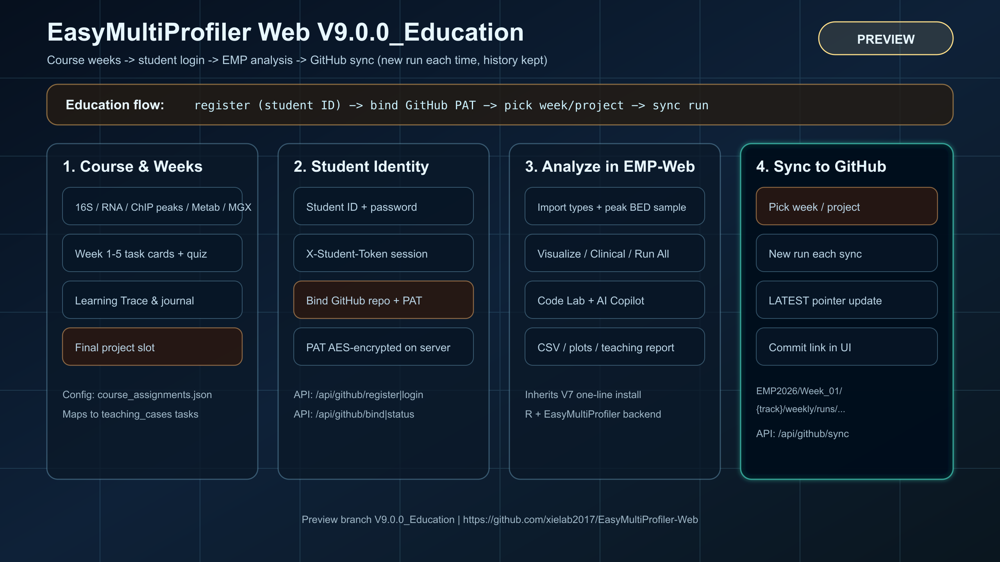

<p align="right">
  <a href="./README_CN.md"></a>
  <a href="./README.md"></a>
</p>

# EasyMultiProfiler Web · v9.3.0


> **Version:** `9.3.0` · **Branch:** [`main`](https://github.com/xielab2017/EasyMultiProfiler-Web/tree/main)
> This is the complete, standalone English documentation for EasyMultiProfiler Web. The Chinese documentation is in [README_CN.md](README_CN.md).

## v9.3.0

See [release notes](docs/RELEASE_NOTES_v9.3.0.md) for changes, validation and limits. This release publishes the current source on main; older installer-package examples below remain historical references. No new binary installers are published with this source update.

- Page-aware Agent chat with image/PDF attachments, optional plans, background task continuation and per-model thinking depth.
- Public matrix discovery/download, paper evidence and explicit sample/design review.
- Saved analysis sources, GO/KEGG and GSEA plots, omics-specific visualizations and PCA dispersion ellipses.
- Shared top/sidebar navigation, synchronized 11-language UI, consistent workbench controls and aligned export cards.
- DESCRIPTION is the release-version source; synchronize generated labels with `python3 webapp/scripts/sync_app_version.py`.

## Integrated count-analysis workbench (local development)

The main sidebar now includes **AI 分析工作台**: send a completed GEO matrix download or explicitly upload a local count table, select sample columns, annotate groups, build/reorder registered steps, review the exact hashed plan, and submit an asynchronous R job. The initial execution adapter supports independent two-group **bulk RNA-seq raw counts**: QC, DESeq2 size-factor normalization, PCA, DESeq2 differential testing and a high-variance heatmap. Results include editable SVG charts, full differential TSV, plan/provenance, software versions and session information.

Full launchers start the metadata/workbench sidecar together with R and the frontend. Local guidance starts on page load; natural-language step generation uses explicitly labelled local rules. The existing opt-in model adapter can inspect a sanitized prepared-workflow summary, search public metadata and propose steps, which can be applied to the editor. Model access needs server-side configuration; live provider calls were not verified. Matrix values and sample labels are excluded from model context. New prepared-input endpoints are for the local owner, not public gateway access.

See [usage, contracts, reproduction and validation](docs/AI_OMICS_WORKBENCH.md). The 12 MiB / one-million-cell analysis limit is separate from the existing original-file download budget. Other omics, batch-adjusted or paired designs, arbitrary DAGs and enrichment are not supported by this new executor. 

The workflow editor now provides eight omics profiles with required gates, optional analyses, automatic prerequisites, order checks and saved per-profile drafts. Capability labels distinguish native count execution, existing-page actions and planning-only steps. The default side panel guides input preparation and scientific review; source code remains in an advanced tab. A unified discovery entry accepts up to ten GEO accessions, a DOI, PMID, paper title or PDF, and hands selected GEO file manifests to the existing download review. See [composer, guidance and paper discovery](docs/OMICS_COMPOSER_AND_DISCOVERY.md) for bounds and verified behavior.

## v9.1.3 — tutorial media and honest playback fallback

**Install the development build:** see [new feature entry instructions](docs/START_NEW_FEATURES.md). Old release packages and the main-branch installer do not include this branch; use the complete development source ZIP in a new folder, then the metadata launcher.

- The startup course page and metadata page link to `tutorial.html`, an original **illustrated** metadata-only walkthrough with offline English narration and Chinese/English subtitles. It is not a screen recording and does not demonstrate R execution or a live AI provider. The production script and narration source make the media reproducible.
- The existing catalog points to 20 full lesson MP4s that are absent from the repository. Those lessons now show a clear missing/decode/network notice, expand their text transcript/storyboard and offer retry. This fix does **not** supply the 20 missing lessons or mark them watched. The existing 30-second preview remains separate.
- The metadata service serves only explicitly allowlisted tutorial assets, supports HTTP byte ranges for seeking and HEAD probes, and retains loopback/origin restrictions. Captions and a text guide remain available when video decoding fails.
- See [v9.1.3 validation and limits](docs/RELEASE_NOTES_v9.1.3.md). No external TTS, stock media, secret or public deployment is required.

## v9.1.2 — installation safety and selected-context agents

- New metadata-only launchers for Linux, macOS and Windows; Python 3.10+ is required, R is not. Run `python webapp/scripts/launch_metadata.py --check` for a read-only dependency report. Use `Start-EMP-Metadata.sh`, `.command` or `.cmd`, or run the Python launcher directly. Clone this independent development branch rather than `main` to reproduce this version.
- Full-service launchers now default to loopback with Funnel off, validate prerequisites/ports, handle quoted paths, and avoid killing unrelated port owners. Nonstandard API/UI ports are passed to the frontend. Existing explicit runtime.env values remain in effect: inspect legacy remote-binding/Funnel settings before starting.
- Fixed Fedora dependency dispatch, macOS R executable paths, web-runtime package dependencies and project-local R library handling. Broken Linux repository/key setup was removed: administrators must provision R >=4.3.3 using approved distro instructions. This is **not** a verified one-click full R installation on every platform.
- The agent can inspect explicitly selected data-manifest, workflow and completed matrix-inspection summaries through a bounded read-only tool. The UI previews sanitized metadata, requires separate context consent, and binds it to a digest. PDFs, matrix values, file paths and sample/group labels are excluded. Tool audit contains name/status/duration, not prompts or credentials.

All 118 Python tests plus Node resolver/locale/syntax checks pass, including Linux mocked/static launcher coverage; native Windows/macOS installation, R execution, complete browser interaction and live model calls remain unverified. See [v9.1.2 notes](docs/RELEASE_NOTES_v9.1.2.md) and [installation audit](docs/INSTALLATION_AUDIT_v9.1.2.md). No exposed key was used; no public deployment or merge was performed.

## v9.1.1 development update

This independent source update adds an optional Python metadata UI/API: GEO/SRA/ENA discovery, confirmed small processed-matrix downloads, local PDF accession extraction, PubMed search/abstracts, typed bulk RNA-seq workflow preflight and opt-in OpenAI/NVIDIA read-only tool adapters. No credentials, user PDFs or downloaded datasets are committed.

Run `python webapp/scripts/public_data_server.py` from the repository root; open `http://127.0.0.1:8081/public_data.html` on that computer. Python standard library covers metadata/matrices; local PDF extraction additionally needs `pypdf`. The existing R backend is separate. The sidecar is loopback-only and the gateway integration is opt-in.

**Validated:** 92 Python tests, frontend JavaScript syntax checks, real GEO/ENA metadata, one 513,592-byte GSE60450 count-matrix download (27,179 genes × 12 precisely matched samples), and real PubMed metadata. **Not validated:** full browser interaction, R analysis, actual provider inference or production deployment. Plans do not execute analysis; other omics are unsupported placeholders. Raw FASTQ downloads remain unavailable. Integer values alone do not establish raw counts.

NVIDIA's requested `nvidia/nemotron-3-ultra-550b-a55b` and its tool API are documented officially, but no live call or key use has occurred. Provider keys are server-only; model access is disabled by default and requires explicit per-request consent. Do not paste keys in chat or commit them.

See [v9.1.1 release notes](docs/RELEASE_NOTES_v9.1.1.md) and [metadata service guide](webapp/docs/PUBLIC_DATA_METADATA.md). This is not a tested v9.1.1 installer release; older v9.1.0 installer examples below are inherited reference instructions. The original v9.1.0 branch is unchanged.


---

## Summary

EasyMultiProfiler Web is a browser-based platform for downstream multi-omics analysis, built on the EasyMultiProfiler R package with a Plumber REST API and a static web front end. It brings the full analysis workflow — import, quality control, preprocessing, differential and diversity analysis, visualization, and export — into a point-and-click interface, so researchers and students can run rigorous multi-omics analyses without writing code, while an integrated Code Lab keeps every step inspectable and reproducible as plain R. The application is **local-first**: it installs and runs on the user's own machine (Windows, macOS, or Linux), data stay on that machine unless the user explicitly syncs results to a GitHub repository, and no account on a remote server is required for local use. Version 9.1.0 adds IP-based user-interface language auto-detection with 11 locales (including right-to-left Arabic), one-click installers for all three operating systems, a rigor quality-control report, background job execution with progress tracking, and reproducible run reports.

---

## Key features

- **Multi-omics workflows in the browser** — dedicated tracks for transcriptomics (RNA-seq), microbiome (16S), metagenomics, metabolomics, ChIP-seq / CUT&RUN (including downstream peak analysis: QC, annotation, motif, differential binding), clinical / phenotype data, and a Customize track, plus cross-omics joint analyses (for example ChIP–RNA).
- **Complete analysis chain** — data import and inspection (EMPT inspector), preprocessing, differential expression / abundance, diversity analysis, enrichment, publication-grade visualization, and clinical modelling, with CSV / PDF / RDS export.
- **Run All** — one-click end-to-end pipelines per track with recommended defaults, executed as background jobs with live progress (see [docs/PERFORMANCE_AND_MEMORY.md](docs/PERFORMANCE_AND_MEMORY.md)).
- **Code Lab** — every workflow step is available as plain R code that can be viewed, edited, fused with external scripts, and re-run, so no-code users and programmers share the same auditable pipeline.
- **AI Copilot** — on-demand interpretation of results and figures, with actionable suggestions that can be sent to Code Lab in one click. AI output is presented as learning support and must be validated against statistics and biology.
- **Course / teaching mode** — weekly assignments (Weeks 1–16) plus major and final projects per track, student sign-in by student ID, and one-click synchronization of each week's work or the final project to the student's own GitHub repository from the Export page, with run history preserved (new `runs/<timestamp>/` folder per sync, nothing overwritten).
- **New in 9.1.0 — multilingual, region-aware UI** — the interface language is auto-detected from the visitor's IP country, falling back to browser language; 11 locales are supported (Simplified Chinese, Traditional Chinese, English, Japanese, Korean, Arabic, Spanish, French, German, Portuguese, Russian), with full right-to-left layout for Arabic and locale-aware plot fonts. Manual selection always overrides auto-detection.
- **New in 9.1.0 — cross-platform one-click installation** — one release package and one double-click installer per operating system (Windows, macOS, Linux); the platform is auto-detected by the installers, by a platform-detection script, and by the `GET /api/system/info` endpoint.
- **New in 9.1.0 — rigor QC** — an automated pre-analysis report on missingness, zero / near-zero variance features, batch–group confounding, and principal-component association with batch or group. The QC only reports; it never silently drops or imputes data.
- **New in 9.1.0 — background jobs and reproducibility** — long analyses run as background jobs with a progress tray (status, cancel, list via `GET /api/jobs`), step-level caching and resume, memory helpers for sparse and chunked computation, and a reproducible report (manifest + report file) capturing versions, platform, parameters, and session information for every run.
- **Privacy by design** — local-first execution; GitHub synchronization is incremental and append-only, and tokens are only used for the repository the user binds.

---

## Installation (one-click, per operating system)

Download the release package for your operating system, extract it, and run the installer at the top level of the extracted folder. The installer checks for Git, Python 3, and R, installs what is missing together with the EasyMultiProfiler dependencies, and starts the web app.

| Operating system | Release package | One-click installer |
|---|---|---|
| **Windows** | `EasyMultiProfiler-Web-v9.1.0-windows.zip` | Double-click `Install-EMP-Web-Windows.bat` |
| **macOS** | `EasyMultiProfiler-Web-v9.1.0-macos.zip` | Double-click `Install-EMP-Web-Mac.command` |
| **Linux** | `EasyMultiProfiler-Web-v9.1.0-linux.zip` | Run `bash Install-EMP-Web-Linux.sh` in a terminal |

Each package also contains a `PLATFORM.txt` naming the target OS, its installer file, and the alternative one-line command below.

### Alternative: one-line install (no download)

The script auto-detects the operating system, installs any missing Git / Python 3 / R / EMP dependencies, and starts the web app.

| Shell | Command |
|---|---|
| **macOS / Linux (bash / zsh)** | `bash -c "$(curl -fsSL https://raw.githubusercontent.com/xielab2017/EasyMultiProfiler-Web/main/webapp/scripts/install_from_github.sh)"` |
| **Windows PowerShell** | `irm https://raw.githubusercontent.com/xielab2017/EasyMultiProfiler-Web/main/webapp/scripts/install_from_github.ps1 \| iex` |

### Alternative: from a cloned repository

```bash
git clone -b main https://github.com/xielab2017/EasyMultiProfiler-Web.git
cd EasyMultiProfiler-Web
bash install.sh                  # macOS / Linux
# or on Windows: install.cmd / Install-EMP-Web-Windows.bat
```

### Quick start

- Web UI: http://127.0.0.1:8080
- API health check: http://127.0.0.1:8000/api/health
- New users: open **Guide** in the left sidebar, or **Course** to load a one-click demo dataset with recommended defaults per lesson.
- For local development: `bash webapp/scripts/start_local.sh`

### Stopping the app

Closing the browser does not stop the background services. Use the stop entry for your platform (in the same folder as the installer):

| Platform | Stop |
|---|---|
| **macOS** | `Stop-EMP-Web-Mac.command`, or `bash webapp/scripts/stop_local.sh` |
| **Windows** | `Stop-EMP-Web-Windows.bat`, or `Restart-EMP-Web.bat` (stop, then start) |
| **Linux** | `Stop-EMP-Web-Linux.sh`, or `bash webapp/scripts/stop_local.sh` |

The stop scripts terminate the API / Web / Gateway processes recorded under `.local_run` and release the default ports `8000` / `8080` / `8090`.

---

## Architecture



> Vector source: [docs/TECHNICAL_MODE_V9_EDUCATION.svg](docs/TECHNICAL_MODE_V9_EDUCATION.svg) (same content as the figure above)

| Layer | Role |
|---|---|
| **Front end** (`webapp/frontend/`) | Static HTML/CSS/JS single-page app: Guide, Course, Import, Summary, Inspector, Prepare, Analyze, ChIP-seq (+ downstream), Clinical, Run All, Visualize, Export; i18n in 11 locales with IP-based auto-detection. |
| **API** (`webapp/backend/plumber.R`) | Plumber REST API exposing import, analysis, visualization, teaching, GitHub sync, jobs, and system endpoints (for example `GET /api/health`, `GET /api/system/info`, `GET /api/jobs`). |
| **R core** (`R/`, `webapp/backend/helpers/`) | The EasyMultiProfiler package plus web helpers: per-omics workflows, ChIP-seq pipelines, rigor QC, caching / parallel / resume, multi-omics joint analysis, reproducible reports, GitHub sync. |
| **Storage** (`webapp/backend/helpers/storage.R`, session helpers) | Local, session-scoped storage of experiments, results, and student profiles on the user's machine; no data leave the machine except explicit GitHub sync. |
| **Jobs** (`webapp/backend/helpers/jobs.R`) | Disk-persistent asynchronous job runner (callr workers): queued / running / done / error state with progress, result files, and cancellation, so long analyses never block the UI. |
| **Course / Sync** | Course tracks and weekly assignments (`webapp/data/course_assignments.json`, `webapp/data/teaching_cases.json`); Export packages a manifest, tables, figures, and a teaching report and pushes them to the student's GitHub repository. |

---

## System requirements

- **Operating system:** Windows 10/11 (x64), macOS (Intel or Apple Silicon), or Linux (for example Ubuntu); WSL is handled by the Unix install path.
- **R:** version 4.3.3 or newer (the package declares `Depends: R (>= 4.3.3)`), with the Bioconductor / CRAN dependencies declared in `DESCRIPTION` (installed automatically by the installers).
- **Python 3** and **Git** (checked and, where possible, installed by the one-click installers; see `webapp/scripts/check_prerequisites.sh` / `.ps1`).
- **Browser:** a current desktop browser for the web UI.
- **Network:** required for installation (package downloads) and for the optional GitHub homework sync; local analysis itself runs offline once installed.

---

## Students: GitHub homework sync (Export page)

1. Open **Export** in the left sidebar.
2. **Register / sign in** with your student ID, your name (required), and a password of at least 8 characters.
3. The class repository is bound automatically when the deployment provides one; otherwise bind your own GitHub repository — you will need a fine-grained personal access token with **Contents: Read and write** on that repository (deployment-wide token and the `EMP_GITHUB_SECRET_KEY` encryption key options are described in [README_CN.md](README_CN.md)).
4. Choose the **course track** and the **weekly assignment / final project**.
5. Click **Sync to GitHub** and follow the returned commit link to verify.

Repository layout: `EMP2026 / Week_XX / <track> / <weekly|project> / runs/<timestamp>/`, with `manifest.json`, `data/`, `results/`, `plots/`, and `teaching/` per run, plus `profile.json` and an append-only `_ledger/` at the repository root. Sync is incremental: each sync creates a new run folder and never deletes existing files.

Main education-sync endpoints: `GET /api/github/assignments`, `POST /api/github/register`, `POST /api/github/login`, `GET /api/github/status`, `POST /api/github/ensure_class_repo`, `POST /api/github/bind`, `POST /api/github/sync`, `GET /api/github/syncs` (student session token sent as `X-Student-Token`).

---

## Documentation

| Document | Contents |
|---|---|
| [docs/RELEASE_NOTES_v9.1.0.md](docs/RELEASE_NOTES_v9.1.0.md) | v9.1.0 release notes (multilingual UI, platform support, analysis upgrades A–D) |
| [docs/I18N_PLATFORM_v910.md](docs/I18N_PLATFORM_v910.md) | Developer documentation: locale architecture, adding a locale, RTL and plot-font rules, platform-detection contract, analysis helper APIs |
| [docs/NAR_MANUSCRIPT_PLAN.md](docs/NAR_MANUSCRIPT_PLAN.md) | Manuscript plan for a Nucleic Acids Research (Web Server issue) submission |
| [docs/PERFORMANCE_AND_MEMORY.md](docs/PERFORMANCE_AND_MEMORY.md) | Memory strategy, background-jobs usage, and multilingual visualization notes |
| [docs/INSTALL_MAC.md](docs/INSTALL_MAC.md) | macOS / Linux installation |
| [docs/INSTALL_WINDOWS.md](docs/INSTALL_WINDOWS.md) | Windows installation |
| [docs/USER_GUIDE_V5.md](docs/USER_GUIDE_V5.md) | User guide |
| [docs/CHIP_OPS_GUIDE.md](docs/CHIP_OPS_GUIDE.md) | ChIP-seq / CUT&RUN Step 1 + Step 2 operation paths |
| [CHANGELOG_V7.md](CHANGELOG_V7.md) | V7 changes |

Interactive help is also available in the web UI under **Guide** and **Course**. LAN / Tailscale access is described in [webapp/docs/LAN_TAILSCALE_ACCESS.md](webapp/docs/LAN_TAILSCALE_ACCESS.md).

---

## Repository layout (summary)

```text
EasyMultiProfiler-Web/
├── DESCRIPTION                 # R package metadata (version 9.3.0)
├── R/                          # EasyMultiProfiler R package
├── Install-EMP-Web-Windows.bat # one-click installers (per OS)
├── Install-EMP-Web-Mac.command
├── Install-EMP-Web-Linux.sh
├── README.md                   # this English documentation
├── README_CN.md                # Chinese documentation
├── README_EN.md                # pointer to README.md (kept for existing links)
├── docs/                       # release notes, guides, manuscript plan
└── webapp/
    ├── backend/                # Plumber API + helpers (workflows, jobs, QC, sync)
    ├── frontend/               # static web UI (11 locales)
    ├── data/                   # course assignments, teaching cases
    └── scripts/                # install, start/stop, platform detection, packaging
```

---

## Availability and license

EasyMultiProfiler Web is freely available from GitHub at https://github.com/xielab2017/EasyMultiProfiler-Web and is distributed under the **Artistic License 2.0** (the license of the EasyMultiProfiler package, consistent with Bioconductor practice). The software runs locally on the user's machine; a hosted demo instance is {{TODO: add public demo URL before journal submission — see docs/NAR_MANUSCRIPT_PLAN.md}}.

## Citation

If you use EasyMultiProfiler Web in your research, please cite the web platform paper (in preparation) and the EasyMultiProfiler core package.

```bibtex
@article{EasyMultiProfilerWeb2026,
  author  = {{TODO: author list to be finalized}},
  title   = {EasyMultiProfiler Web: a local-first, multilingual web platform for downstream multi-omics analysis},
  journal = {Nucleic Acids Research},
  year    = {{TODO: year}},
  volume  = {{TODO: volume}},
  pages   = {{TODO: pages}},
  doi     = {{TODO: DOI}}
}
```

The EasyMultiProfiler core R package that powers the analysis back end should be cited as described on the package / Bioconductor reference page (see the repository home page). Exact bibliographic details are intentionally left as `{{TODO: ...}}` placeholders until they are final; no citation data are fabricated in this document.

## Contact

Xie Lab, Faculty of Synthetic Biology, Shenzhen University of Advanced Technology (SUAT) — https://github.com/xielab2017


## Local matrix download panel (unreleased)

The main application now contains a Matrix download navigation page. It searches GEO, selects a supplementary original file, shows the exact source and a user-selected byte budget, downloads in the background, streams the saved file through the same-origin main page, and retrieves source-preserving sample annotations. No raw-read processing, AI request or R analysis is triggered. Default per-file budget is 5 GiB, adjustable up to 100 GiB subject to available disk and a 1 GiB reserve. Formats may be downloaded unchanged; archives are not automatically extracted. Preview/annotation limits are independent from file download limits. See docs/MATRIX_MAIN_PANEL.md for operation, safety and validation limits. This local increment has not been pushed to GitHub.
