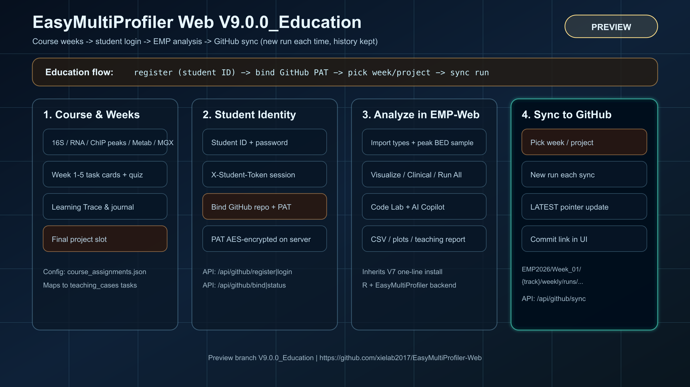

<p align="right">
  <a href="./README_CN.md"></a>
  <a href="./README.md"></a>
</p>

# EasyMultiProfiler Web · v9.1.0


> **Version:** `9.1.0` · **Branch:** [`main`](https://github.com/xielab2017/EasyMultiProfiler-Web/tree/main)
> This is the complete, standalone English documentation for EasyMultiProfiler Web. The Chinese documentation is in [README_CN.md](README_CN.md).


---

## Summary

EasyMultiProfiler Web is a browser-based platform for downstream multi-omics analysis, built on the EasyMultiProfiler R package with a Plumber REST API and a static web front end. It brings the full analysis workflow — import, quality control, preprocessing, differential and diversity analysis, visualization, and export — into a point-and-click interface, so researchers and students can run rigorous multi-omics analyses without writing code, while an integrated Code Lab keeps every step inspectable and reproducible as plain R. The application is **local-first**: it installs and runs on the user's own machine (Windows, macOS, or Linux), data stay on that machine unless the user explicitly syncs results to a GitHub repository, and no account on a remote server is required for local use. Version 9.1.0 adds IP-based user-interface language auto-detection with 11 locales (including right-to-left Arabic), one-click installers for all three operating systems, a rigor quality-control report, background job execution with progress tracking, and reproducible run reports.

---

## Key features

- **Multi-omics workflows in the browser** — dedicated tracks for transcriptomics (RNA-seq), microbiome (16S), metagenomics, metabolomics, ChIP-seq / CUT&RUN (including downstream peak analysis: QC, annotation, motif, differential binding), clinical / phenotype data, and a Customize track, plus cross-omics joint analyses (for example ChIP–RNA).
- **Complete analysis chain** — data import and inspection (EMPT inspector), preprocessing, differential expression / abundance, diversity analysis, enrichment, publication-grade visualization, and clinical modelling, with CSV / PDF / RDS export.
- **Run All** — one-click end-to-end pipelines per track with recommended defaults, executed as background jobs with live progress (see [docs/PERFORMANCE_AND_MEMORY.md](docs/PERFORMANCE_AND_MEMORY.md)).
- **Code Lab** — every workflow step is available as plain R code that can be viewed, edited, fused with external scripts, and re-run, so no-code users and programmers share the same auditable pipeline.
- **AI Copilot** — on-demand interpretation of results and figures, with actionable suggestions that can be sent to Code Lab in one click. AI output is presented as learning support and must be validated against statistics and biology.
- **Course / teaching mode** — weekly assignments (Weeks 1–16) plus major and final projects per track, student sign-in by student ID, and one-click synchronization of each week's work or the final project to the student's own GitHub repository from the Export page, with run history preserved (new `runs/<timestamp>/` folder per sync, nothing overwritten).
- **New in 9.1.0 — multilingual, region-aware UI** — the interface language is auto-detected from the visitor's IP country, falling back to browser language; 11 locales are supported (Simplified Chinese, Traditional Chinese, English, Japanese, Korean, Arabic, Spanish, French, German, Portuguese, Russian), with full right-to-left layout for Arabic and locale-aware plot fonts. Manual selection always overrides auto-detection.
- **New in 9.1.0 — cross-platform one-click installation** — one release package and one double-click installer per operating system (Windows, macOS, Linux); the platform is auto-detected by the installers, by a platform-detection script, and by the `GET /api/system/info` endpoint.
- **New in 9.1.0 — rigor QC** — an automated pre-analysis report on missingness, zero / near-zero variance features, batch–group confounding, and principal-component association with batch or group. The QC only reports; it never silently drops or imputes data.
- **New in 9.1.0 — background jobs and reproducibility** — long analyses run as background jobs with a progress tray (status, cancel, list via `GET /api/jobs`), step-level caching and resume, memory helpers for sparse and chunked computation, and a reproducible report (manifest + report file) capturing versions, platform, parameters, and session information for every run.
- **Privacy by design** — local-first execution; GitHub synchronization is incremental and append-only, and tokens are only used for the repository the user binds.

---

## Installation (one-click, per operating system)

Download the release package for your operating system, extract it, and run the installer at the top level of the extracted folder. The installer checks for Git, Python 3, and R, installs what is missing together with the EasyMultiProfiler dependencies, and starts the web app.

| Operating system | Release package | One-click installer |
|---|---|---|
| **Windows** | `EasyMultiProfiler-Web-v9.1.0-windows.zip` | Double-click `Install-EMP-Web-Windows.bat` |
| **macOS** | `EasyMultiProfiler-Web-v9.1.0-macos.zip` | Double-click `Install-EMP-Web-Mac.command` |
| **Linux** | `EasyMultiProfiler-Web-v9.1.0-linux.zip` | Run `bash Install-EMP-Web-Linux.sh` in a terminal |

Each package also contains a `PLATFORM.txt` naming the target OS, its installer file, and the alternative one-line command below.

### Alternative: one-line install (no download)

The script auto-detects the operating system, installs any missing Git / Python 3 / R / EMP dependencies, and starts the web app.

| Shell | Command |
|---|---|
| **macOS / Linux (bash / zsh)** | `bash -c "$(curl -fsSL https://raw.githubusercontent.com/xielab2017/EasyMultiProfiler-Web/main/webapp/scripts/install_from_github.sh)"` |
| **Windows PowerShell** | `irm https://raw.githubusercontent.com/xielab2017/EasyMultiProfiler-Web/main/webapp/scripts/install_from_github.ps1 \| iex` |

### Alternative: from a cloned repository

```bash
git clone -b main https://github.com/xielab2017/EasyMultiProfiler-Web.git
cd EasyMultiProfiler-Web
bash install.sh                  # macOS / Linux
# or on Windows: install.cmd / Install-EMP-Web-Windows.bat
```

### Quick start

- Web UI: http://127.0.0.1:8080
- API health check: http://127.0.0.1:8000/api/health
- New users: open **Guide** in the left sidebar, or **Course** to load a one-click demo dataset with recommended defaults per lesson.
- For local development: `bash webapp/scripts/start_local.sh`

### Stopping the app

Closing the browser does not stop the background services. Use the stop entry for your platform (in the same folder as the installer):

| Platform | Stop |
|---|---|
| **macOS** | `Stop-EMP-Web-Mac.command`, or `bash webapp/scripts/stop_local.sh` |
| **Windows** | `Stop-EMP-Web-Windows.bat`, or `Restart-EMP-Web.bat` (stop, then start) |
| **Linux** | `Stop-EMP-Web-Linux.sh`, or `bash webapp/scripts/stop_local.sh` |

The stop scripts terminate the API / Web / Gateway processes recorded under `.local_run` and release the default ports `8000` / `8080` / `8090`.

---

## Architecture



> Vector source: [docs/TECHNICAL_MODE_V9_EDUCATION.svg](docs/TECHNICAL_MODE_V9_EDUCATION.svg) (same content as the figure above)

| Layer | Role |
|---|---|
| **Front end** (`webapp/frontend/`) | Static HTML/CSS/JS single-page app: Guide, Course, Import, Summary, Inspector, Prepare, Analyze, ChIP-seq (+ downstream), Clinical, Run All, Visualize, Export; i18n in 11 locales with IP-based auto-detection. |
| **API** (`webapp/backend/plumber.R`) | Plumber REST API exposing import, analysis, visualization, teaching, GitHub sync, jobs, and system endpoints (for example `GET /api/health`, `GET /api/system/info`, `GET /api/jobs`). |
| **R core** (`R/`, `webapp/backend/helpers/`) | The EasyMultiProfiler package plus web helpers: per-omics workflows, ChIP-seq pipelines, rigor QC, caching / parallel / resume, multi-omics joint analysis, reproducible reports, GitHub sync. |
| **Storage** (`webapp/backend/helpers/storage.R`, session helpers) | Local, session-scoped storage of experiments, results, and student profiles on the user's machine; no data leave the machine except explicit GitHub sync. |
| **Jobs** (`webapp/backend/helpers/jobs.R`) | Disk-persistent asynchronous job runner (callr workers): queued / running / done / error state with progress, result files, and cancellation, so long analyses never block the UI. |
| **Course / Sync** | Course tracks and weekly assignments (`webapp/data/course_assignments.json`, `webapp/data/teaching_cases.json`); Export packages a manifest, tables, figures, and a teaching report and pushes them to the student's GitHub repository. |

---

## System requirements

- **Operating system:** Windows 10/11 (x64), macOS (Intel or Apple Silicon), or Linux (for example Ubuntu); WSL is handled by the Unix install path.
- **R:** version 4.3.3 or newer (the package declares `Depends: R (>= 4.3.3)`), with the Bioconductor / CRAN dependencies declared in `DESCRIPTION` (installed automatically by the installers).
- **Python 3** and **Git** (checked and, where possible, installed by the one-click installers; see `webapp/scripts/check_prerequisites.sh` / `.ps1`).
- **Browser:** a current desktop browser for the web UI.
- **Network:** required for installation (package downloads) and for the optional GitHub homework sync; local analysis itself runs offline once installed.

---

## Students: GitHub homework sync (Export page)

1. Open **Export** in the left sidebar.
2. **Register / sign in** with your student ID, your name (required), and a password of at least 8 characters.
3. The class repository is bound automatically when the deployment provides one; otherwise bind your own GitHub repository — you will need a fine-grained personal access token with **Contents: Read and write** on that repository (deployment-wide token and the `EMP_GITHUB_SECRET_KEY` encryption key options are described in [README_CN.md](README_CN.md)).
4. Choose the **course track** and the **weekly assignment / final project**.
5. Click **Sync to GitHub** and follow the returned commit link to verify.

Repository layout: `EMP2026 / Week_XX / <track> / <weekly|project> / runs/<timestamp>/`, with `manifest.json`, `data/`, `results/`, `plots/`, and `teaching/` per run, plus `profile.json` and an append-only `_ledger/` at the repository root. Sync is incremental: each sync creates a new run folder and never deletes existing files.

Main education-sync endpoints: `GET /api/github/assignments`, `POST /api/github/register`, `POST /api/github/login`, `GET /api/github/status`, `POST /api/github/ensure_class_repo`, `POST /api/github/bind`, `POST /api/github/sync`, `GET /api/github/syncs` (student session token sent as `X-Student-Token`).

---

## Documentation

| Document | Contents |
|---|---|
| [docs/RELEASE_NOTES_v9.1.0.md](docs/RELEASE_NOTES_v9.1.0.md) | v9.1.0 release notes (multilingual UI, platform support, analysis upgrades A–D) |
| [docs/I18N_PLATFORM_v910.md](docs/I18N_PLATFORM_v910.md) | Developer documentation: locale architecture, adding a locale, RTL and plot-font rules, platform-detection contract, analysis helper APIs |
| [docs/NAR_MANUSCRIPT_PLAN.md](docs/NAR_MANUSCRIPT_PLAN.md) | Manuscript plan for a Nucleic Acids Research (Web Server issue) submission |
| [docs/PERFORMANCE_AND_MEMORY.md](docs/PERFORMANCE_AND_MEMORY.md) | Memory strategy, background-jobs usage, and multilingual visualization notes |
| [docs/INSTALL_MAC.md](docs/INSTALL_MAC.md) | macOS / Linux installation |
| [docs/INSTALL_WINDOWS.md](docs/INSTALL_WINDOWS.md) | Windows installation |
| [docs/USER_GUIDE_V5.md](docs/USER_GUIDE_V5.md) | User guide |
| [docs/CHIP_OPS_GUIDE.md](docs/CHIP_OPS_GUIDE.md) | ChIP-seq / CUT&RUN Step 1 + Step 2 operation paths |
| [CHANGELOG_V7.md](CHANGELOG_V7.md) | V7 changes |

Interactive help is also available in the web UI under **Guide** and **Course**. LAN / Tailscale access is described in [webapp/docs/LAN_TAILSCALE_ACCESS.md](webapp/docs/LAN_TAILSCALE_ACCESS.md).

---

## Repository layout (summary)

```text
EasyMultiProfiler-Web/
├── DESCRIPTION                 # R package metadata (version 9.1.0)
├── R/                          # EasyMultiProfiler R package
├── Install-EMP-Web-Windows.bat # one-click installers (per OS)
├── Install-EMP-Web-Mac.command
├── Install-EMP-Web-Linux.sh
├── README.md                   # this English documentation
├── README_CN.md                # Chinese documentation
├── README_EN.md                # pointer to README.md (kept for existing links)
├── docs/                       # release notes, guides, manuscript plan
└── webapp/
    ├── backend/                # Plumber API + helpers (workflows, jobs, QC, sync)
    ├── frontend/               # static web UI (11 locales)
    ├── data/                   # course assignments, teaching cases
    └── scripts/                # install, start/stop, platform detection, packaging
```

---

## Availability and license

EasyMultiProfiler Web is freely available from GitHub at https://github.com/xielab2017/EasyMultiProfiler-Web and is distributed under the **Artistic License 2.0** (the license of the EasyMultiProfiler package, consistent with Bioconductor practice). The software runs locally on the user's machine; a hosted demo instance is {{TODO: add public demo URL before journal submission — see docs/NAR_MANUSCRIPT_PLAN.md}}.

## Citation

If you use EasyMultiProfiler Web in your research, please cite the web platform paper (in preparation) and the EasyMultiProfiler core package.

```bibtex
@article{EasyMultiProfilerWeb2026,
  author  = {{TODO: author list to be finalized}},
  title   = {EasyMultiProfiler Web: a local-first, multilingual web platform for downstream multi-omics analysis},
  journal = {Nucleic Acids Research},
  year    = {{TODO: year}},
  volume  = {{TODO: volume}},
  pages   = {{TODO: pages}},
  doi     = {{TODO: DOI}}
}
```

The EasyMultiProfiler core R package that powers the analysis back end should be cited as described on the package / Bioconductor reference page (see the repository home page). Exact bibliographic details are intentionally left as `{{TODO: ...}}` placeholders until they are final; no citation data are fabricated in this document.

## Contact

Xie Lab, Faculty of Synthetic Biology, Shenzhen University of Advanced Technology (SUAT) — https://github.com/xielab2017
