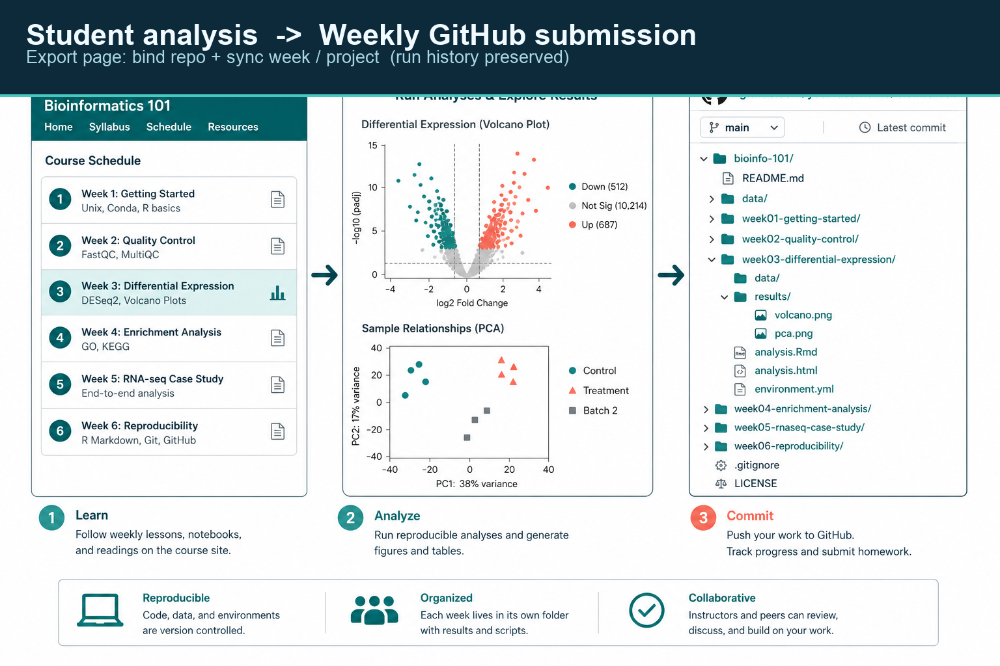
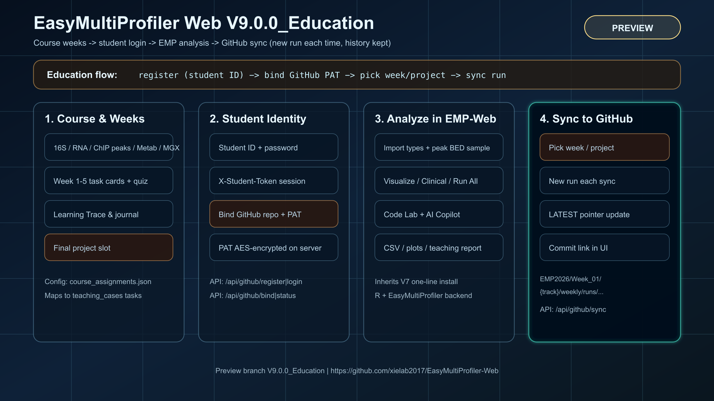

<p align="right">
  <a href="./README_CN.md"></a>
  <a href="./README.md"></a>
</p>

# EasyMultiProfiler Web · v9.1.2

**开发版源码 · 内部版本 9.1.2** — 在 V7 一键安装与多组学分析能力之上，包含 **课程按周作业 + 学号登录 + GitHub 仓库同步**，以及 ChIP / 多组学联合等 V9 能力。


> **分支**：[`codex/v9.1.0-public-data-metadata`](https://github.com/xielab2017/EasyMultiProfiler-Web/tree/codex/v9.1.0-public-data-metadata)
> **版本**：`9.1.2`

## v9.1.2 — 安装安全与选中上下文智能体

- 新增Linux/macOS/Windows元数据专用启动器，需Python≥3.10，不需要R。运行 `python webapp/scripts/launch_metadata.py --check` 查看只读诊断；按平台使用 `Start-EMP-Metadata.sh` / `.command` / `.cmd`。复现此版应克隆当前独立开发分支，不是main。
- 完整服务默认loopback、Funnel关闭，增加依赖/端口检查、空格路径支持，不再因端口占用误杀其他进程；自定义API/Web端口传递给前端。旧runtime.env的显式设置仍保留，启动前应核查旧的远程绑定/Funnel配置。
- 修复Fedora依赖分发、Mac R路径、web运行依赖和项目本地R库。原Linux仓库/签名设置错误，已删除该不安全自动配置；管理员需先从经批准来源安装R≥4.3.3，不宣称各平台完整R环境一键安装已验证。
- AI可通过受限只读工具查看用户选中的数据清单、流程及已完成矩阵检查摘要。网页先预览脱敏摘要、单独确认发送，再用指纹绑定；不发送PDF、矩阵数值、路径或样本/组别名称。审计只含工具名/状态/耗时。

118项Python测试及Node端口/国际化/语法检查通过，包含Linux静态/模拟启动覆盖；Windows/macOS原生安装、R分析、完整浏览器交互与真实模型调用仍未验证。详见[版本说明](docs/RELEASE_NOTES_v9.1.2.md)和[安装审查](docs/INSTALLATION_AUDIT_v9.1.2.md)。未使用暴露密钥，未合并或部署公网。

## v9.1.1 独立开发更新

新增可选Python网页/接口：GEO/SRA/ENA元数据、确认后的小型processed矩阵下载、本地PDF候选提取、PubMed检索/摘要、bulk RNA-seq可编辑流程预检，以及默认禁用的OpenAI/NVIDIA只读智能体适配。代码不包含密钥、用户PDF或下载数据。

仓库根目录运行 `python webapp/scripts/public_data_server.py`，在同一电脑打开 `http://127.0.0.1:8081/public_data.html`。元数据/矩阵功能使用Python标准库，PDF解析另需pypdf。服务仅监听loopback；现有R后端独立，可选网关需显式启用。

**验证范围：**92项Python测试、前端JS语法检查、真实GEO/ENA/PubMed元数据，以及GSE60450的513,592字节计数矩阵下载（27,179基因×12个精确匹配样本）。**未验证：**完整浏览器交互、R分析、真实模型调用或生产部署。流程仅预检不执行；其他组学明确未支持；不下载FASTQ；整数表不自动视为raw counts。

NVIDIA指定模型 `nvidia/nemotron-3-ultra-550b-a55b` 及工具调用有官方文档，但尚未真实调用或使用密钥。密钥仅由服务器安全配置，模型默认关闭，每次请求需明确同意发送范围。

详见[版本说明](docs/RELEASE_NOTES_v9.1.1.md)与[元数据服务指南](webapp/docs/PUBLIC_DATA_METADATA.md)。本次为源码开发更新，不宣称已构建/验证9.1.1安装包；下方旧安装说明作为既有功能参考。原v9.1.0分支不变。


---

## 这是什么

EasyMultiProfiler Web 是浏览器版多组学下游分析平台（Plumber R API + 静态前端 + EasyMultiProfiler 核心）。

**v9.1.0** 面向科研与教学场景，学生与课程用户可以：

1. 在 **Course** 里按 case / 周次完成微课、测验与实操  
2. 用 **学号 + 姓名（必填）+ 自设口令** 登录课程身份  
3. 填写并连接到自己有写权限的 GitHub 作业仓库  
4. 在 **Export** 页一键把本周作业或期末项目同步到目标仓库（**每次新建 run，保留历史**）  
5. 需要时仍可本地下载 CSV / PDF / RDS



---

## 架构一览



> 矢量源文件：[docs/TECHNICAL_MODE_V9_EDUCATION.svg](docs/TECHNICAL_MODE_V9_EDUCATION.svg)（与上图同内容）

| 层 | 能力 |
|----|------|
| Course | 4 条组学轨道 + **自定义 (Customize)**；作业为第 **1–16 周** + 课程大作业 + 期末项目 + 自定义作业 |
| Student | 学号注册登录；服务端会话 token（`X-Student-Token`） |
| Analyze | 完整继承 V7：导入、预处理、差异/多样性、可视化、Clinical、Run All、Code Lab、AI |
| Sync | 打包 manifest / 表格 / 图 / 教学报告 → 推送到学生仓库约定目录 |

---

## 一键安装（按操作系统）

下载与你的系统对应的发布包，解压后运行包内根目录的一键安装文件即可（会自动检查并补齐 git / python3 / R 与 EMP 依赖，并启动网页）：

| 操作系统 | 发布包 | 一键安装 |
|------|------|------|
| **Windows** | `EasyMultiProfiler-Web-v9.1.0-windows.zip` | 双击 `Install-EMP-Web-Windows.bat` |
| **macOS** | `EasyMultiProfiler-Web-v9.1.0-macos.zip` | 双击 `Install-EMP-Web-Mac.command` |
| **Linux** | `EasyMultiProfiler-Web-v9.1.0-linux.zip` | 终端运行 `bash Install-EMP-Web-Linux.sh` |

每个发布包内还有一个 `PLATFORM.txt`，写明该平台的安装入口与备用的一行命令。

## 一行命令启动（main）

脚本会自动识别 OS，安装缺失的 git / python3 / R / EMP 依赖并启动网页。

| Shell | 命令 |
|------|------|
| **macOS / Linux（bash / zsh）** | `bash -c "$(curl -fsSL https://raw.githubusercontent.com/xielab2017/EasyMultiProfiler-Web/main/webapp/scripts/install_from_github.sh)"` |
| **Windows PowerShell** | `irm https://raw.githubusercontent.com/xielab2017/EasyMultiProfiler-Web/main/webapp/scripts/install_from_github.ps1 \| iex` |

### 已 clone 仓库

```bash
git clone -b main https://github.com/xielab2017/EasyMultiProfiler-Web.git
cd EasyMultiProfiler-Web
bash install.sh                  # macOS / Linux
# 或 Windows：install.cmd / Start-EMP-Web.bat
```

本地开发常用：

```bash
bash webapp/scripts/start_local.sh
```

- 网页：http://127.0.0.1:8080  
- API：http://127.0.0.1:8000/api/health  

### 终止运行 / Stop

关闭浏览器不会停止后台服务。请用对应平台的停止入口（与启动脚本同目录）：

| 平台 | 双击 / 命令 |
|------|-------------|
| **macOS** | `Stop-EMP-Web-Mac.command`，或 `bash webapp/scripts/stop_local.sh` |
| **Windows** | `Stop-EMP-Web-Windows.bat`，或 `Restart-EMP-Web.bat`（先停再启） |

停止脚本会结束 `.local_run` 中记录的 API / Web / Gateway PID，并释放默认端口 `8000` / `8080` / `8090`。

---

## 学生：GitHub 作业同步（Export 页）

### 准备

1. 学生在 Export 页填写自己的 GitHub 仓库 URL  
2. 部署端也可选设置 `EMP_CLASS_HOMEWORK_REPO` 与 `EMP_CLASS_GITHUB_TOKEN`，用于指定统一仓库并自动绑定  
3. 未配置统一仓库时，学生准备自己的 PAT（fine-grained，对目标仓库 **Contents: Read and write**）  
4. （可选）设置 `EMP_GITHUB_SECRET_KEY`，用于加密存储 Token  

### 操作步骤

1. 打开左侧 **Export**  
2. **注册 / 登录**（学号 + **姓名必填** + 口令 ≥ 8 位）  
3. 仓库地址已锁定为课堂仓库；若提示需要 Token，粘贴 PAT 后点 **绑定仓库**  
4. 选择 **课程轨道** 与 **本周作业 / 期末项目**  
5. 点击 **同步到 GitHub** → 打开返回的 commit 链接核对  

### 仓库目录约定

```text
EMP2026/
  Week_01/
    microbiome_16s/
      weekly/
        LATEST
        runs/<timestamp>/
          manifest.json      # 含学号、版本、GitHub、git_path
          data/ results/ plots/ teaching/
    transcriptomics/
      weekly/
        ...
  Week_02/
    ...
  Project_Major/
    transcriptomics/
      project/
        runs/...
  profile.json               # 学号、GitHub 账号/仓库、EMP 版本、最近 git_path
  _ledger/<run_id>.json      # 每次同步一条记录（增量，不擦除历史）
  README.md
```

路径规则：`EMP2026 / Week_XX / <课程轨道> / <作业类型> / runs / ...`  
- 周次文件夹：`Week_01` … `Week_16`（便于排序；界面下拉显示为 Week 1–16）  
- 轨道在周次之下（如 `transcriptomics`、`microbiome_16s`、`clinical`）  
- 作业类型：`weekly`（周作业）或 `project`（项目大作业，在 `Project_Major/` 下）

同步策略：**增量写入**；每次新建 `runs/<时间戳>/`，不删除仓库已有文件。

---

## 教师 / 助教提示

- 作业槽位定义：[`webapp/data/course_assignments.json`](webapp/data/course_assignments.json)  
- 教学 case：[`webapp/data/teaching_cases.json`](webapp/data/teaching_cases.json)  
- 学生资料目录：平台数据根下 `students/`（可用 `EMP_STUDENTS_DIR` 覆盖）  
- 批改时可看学生仓库 `Week_XX/<track>/weekly/` 与 `profile.json` / `_ledger/`  
- 每次同步会写入学号、GitHub 登录名/仓库、EMP 版本号与 `git_path` 
- 局域网 / Tailscale 访问说明：[`webapp/docs/LAN_TAILSCALE_ACCESS.md`](webapp/docs/LAN_TAILSCALE_ACCESS.md)

---

## 主要 API（教育同步）

| 方法 | 路径 | 说明 |
|------|------|------|
| GET | `/api/github/assignments` | 周次 / 项目作业列表 |
| POST | `/api/github/register` | 学号注册（姓名必填）；含课堂仓库 ensure |
| POST | `/api/github/login` | 登录，返回 `student_token` + 课堂仓库状态 |
| GET | `/api/github/status` | 登录与绑定状态（含 `class_homework_repo`） |
| POST | `/api/github/ensure_class_repo` | 确保绑定课堂作业仓库 |
| POST | `/api/github/bind` | 绑定课堂 repo + PAT（始终指向课堂仓库） |
| POST | `/api/github/sync` | 同步到指定周 / 项目 |
| GET | `/api/github/syncs` | 本机同步历史 |

请求头：`X-Student-Token: <token>`（登录后由前端自动携带）。

---

## 相对 V7 的新增点

- 课程 **按周** 作业模型（对接 case task）  
- **学号 + 口令** 学生身份  
- **GitHub 绑定与一键同步**（run 历史保留）  
- Export 页 GitHub 课程仓库面板（中英 i18n）  
- 继承 V7：零依赖一键安装、多组学工作流、AI Copilot、Code Lab、Run All 等  

技术架构图（V7 分析核心仍适用）：[`docs/TECHNICAL_MODE_V6.svg`](docs/TECHNICAL_MODE_V6.svg)

---

## 文档索引

| 文档 | 内容 |
|------|------|
| [docs/INSTALL_MAC.md](docs/INSTALL_MAC.md) | macOS / Linux 安装 |
| [docs/INSTALL_WINDOWS.md](docs/INSTALL_WINDOWS.md) | Windows 安装 |
| [docs/USER_GUIDE_V5.md](docs/USER_GUIDE_V5.md) | 用户操作指南 |
| [docs/CHIP_OPS_GUIDE.md](docs/CHIP_OPS_GUIDE.md) | ChIP-seq / CUT&RUN Step1+Step2 操作路径 |
| [docs/RELEASE_NOTES_v9.1.0.md](docs/RELEASE_NOTES_v9.1.0.md) | 本版说明 |
| [docs/NAR_MANUSCRIPT_PLAN.md](docs/NAR_MANUSCRIPT_PLAN.md) | NAR (Web Server issue) 投稿计划 |
| [CHANGELOG_V7.md](CHANGELOG_V7.md) | V7 变更 |

Full English documentation: [README.md](README.md) is the complete, standalone English README for v9.1.0 (installation, features, architecture, citation).

网页内左侧 **Guide** / **Course** 也有交互说明。

---

## 仓库结构（摘要）

```text
EasyMultiProfiler-Web/
├── DESCRIPTION
├── R/                          # EMP R 包
├── docs/
│   ├── images/                 # README 配图（banner / sync / architecture PNG）
│   ├── TECHNICAL_MODE_V9_EDUCATION.svg
│   └── RELEASE_NOTES_v9.1.0.md
├── README.md                   # English (main)
├── README_CN.md                # 中文（本文件）
├── README_EN.md                # English pointer page
└── webapp/
    ├── backend/helpers/github_sync.R
    ├── data/course_assignments.json
    ├── data/teaching_cases.json
    ├── frontend/js/github_sync.js
    └── scripts/                # 安装与本地启动
```

---

## 成功标志

- 前端打开 **Course** / **Export**，可见 GitHub 同步卡片  
- `GET /api/github/assignments` 返回 4 条轨道与周次  
- 学生绑定仓库后，同步可在 GitHub 看到新 commit  

---

## License

Artistic-2.0（与 Bioconductor 一致）。

## Citation

请参考仓库主页与 EasyMultiProfiler / Bioconductor 引用说明：  
https://github.com/xielab2017/EasyMultiProfiler-Web
