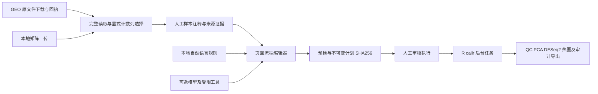

# AI 组学分析工作台

此本地增量把公开计数矩阵下载、自然语言助手、页面流程编排和 R 后台执行连接起来。首个可执行闭环是 bulk RNA-seq raw counts；现有其他组学页面继续提供各自功能，此执行器没有验证它们，也没有实现任意多组学 DAG。

后续增量已加入八类组学的必需/可选步骤库、依赖检查、右侧默认分析引导，以及 GEO/DOI/PMID/题目/PDF 统一检索。当前行为与新增验收见 [流程编排与论文数据检索](OMICS_COMPOSER_AND_DISCOVERY.md)；下文先前验收记录按当时范围保留。

## 页面入口与语言同步修复（2026-11-07）

必须从 HTTP 地址打开应用。直接用 `file://.../index.html` 打开会阻止 ES 模块加载，表现为页面可见而按钮无响应。新增独立的 classic-script 提示，即使模块不可用也会说明原因，并链接到生成的本机运行端口。没有自动跳转、绕过浏览器限制或修改浏览器安全设置。

本次已启动当前源码的本机应用：`http://127.0.0.1:18080/`，R API 18000、元数据服务 18081，均仅监听 loopback；原来的 8000/8080/8081 服务没有停止。新实例的记录和日志位于 `.local_run/workbench_runtime/`，R 数据位于其中的 `data/`，原有会话目录没有改写。停止脚本已纳入该实例的 PID 文件，并继续核对源码目录归属。

矩阵页和工作台已接入全局语言选择，新增页面标题和导航覆盖 11 个选项。新增页面的完整正文、按钮、占位文字、状态提示、动态步骤与参数标签提供中英文；其余长尾语言沿用项目现有英文回退规则，不宣称完整翻译了全部 11 种语言。切换语言只更新显示，不改样本标签、分组、问题文字、参数、已准备计划或执行同意。

验证：25 项 Node 检查通过（含静态文案覆盖、语言切换保留输入、file 入口提示及既有矩阵回归）；原语言映射测试和启动器检查通过。本机浏览器实际验证了工作台的中文→英文切换、填写字段与数值参数保留、自然语言生成步骤及矩阵页的英文示例按钮/动态提示。未通过浏览器自动化打开 file URL（该地址被工具的 URL 策略限制），入口提示使用无模块 VM 测试验证。

## 使用

使用当前完整源码的启动器：

```bash
bash webapp/scripts/start_local.sh
```

macOS / Linux 需要 Python >=3.10、R >=4.3.3 和项目已有依赖。若系统 `python3` 是旧版，设置 `EMPI_PYTHON` 指向已安装的合适解释器，例如项目已有的 `.local_run/metadata_venv/bin/python`。Windows 使用 `webapp/scripts/start_local_windows.ps1`。本次未执行原生 Windows 启动验证。

完整启动器同时管理 R API、静态页面及元数据/工作台服务。元数据端口默认 8081，可通过 `EMP_PUBLIC_DATA_PORT` 配置，须与 API、页面及 gateway 端口不同。停止脚本只处理当前源码目录记录且能核对身份的 PID。启动器涉及已有服务的重启，请在当前任务结束后再使用；本次验证使用独立端口，没有重启用户现有服务。

1. 在“矩阵下载”页检索 GSE，选择具体补充文件并审核下载计划。完成后点击“将当前已完成的下载送入 AI 分析工作台”。也可直接上传 UTF-8 CSV/TSV/TXT（支持 gzip）。
2. 完整读取文件后，明确选择真正的样本计数列。`Length` 等列仅标为候选注释，默认仍勾选，须由使用者核对。排除列进入审核计划，原文件保留。
3. 为每个选定样本填写真实组别，明确实验组/参考组方向，记录作者说明或其他可核对的 raw-count 来源依据。不得从整数、列名或文件名推断 raw counts、组别或独立生物学重复。
4. 使用模板，或输入“对这个 RNA-seq 计数矩阵做完整差异分析，查看 PCA 和热图”。可拖动步骤、用上移/下移按钮排序、增删操作及编辑数值参数。预检会拒绝不符合依赖的排序。
5. 点击“检查并准备流程”，审阅数据、排除列、样本、方向和参数，再确认运行。任何编辑会使先前的准备和同意失效。相同计划在同一 R 服务中重复提交会返回同一任务 ID；改变计划或 seed 才生成新执行。
6. 任务可刷新、取消，页面关闭后可凭任务 ID 查询。结果含 QC、PCA、热图、完整差异表和审计 JSON。SVG 的文本、点、色块均为矢量元素。差异表保留缺失统计量与小 P 值，正 log2FC 表示实验组 / 参考组。

## AI 的启动与执行边界

页面加载时会自动检查能力并启动本地分步引导，不会发出大模型请求。“生成分析流程”明确使用本地关键词规则，不声称是大模型推理，也不推断分组。

“请 AI 深入指导”复用 `agent_adapter.py`，服务端通过 `EMP_AGENT_PROVIDER`、对应 provider 的环境凭证、`EMP_AGENT_MODEL` 和 `EMP_AGENT_ALLOW_MODEL_REQUEST=1` 配置。凭证不应写入代码、页面表单或浏览器存储。沿用适配器的固定 provider 地址和模型约束；本次没有配置/使用新凭证，也没有验证真实模型调用。

准备流程后可预览模型可见摘要：样本数、已登记操作和参数、来源校验值及独立样本声明。矩阵数值、样本/组别标签、自由文本证据、路径和附件不进入该上下文。问题框中的文字会在本次明确同意后发送，因此不要粘贴私人数据。模型提出的步骤可一键应用到编辑器，之后仍需本地预检和独立执行审核。模型工具没有运行、上传或任意代码执行能力。

## 科学范围

- 输入：一份矩阵，2–256 个明确选定样本、2–50,000 个特征、最多 1,000,000 单元格。压缩与解压后的原文件均 <=12 MiB；可下载的大文件不因此变小，超限文件仍完整保留在下载区。
- 计数必须为有限、非负、精确整数且 <=2,147,483,647。拒绝缺失、负值、小数、重复特征和样本 ID；没有自动舍入、填补或去重。每列须有正的 library size。
- 每个样本的元数据 ID 与矩阵严格匹配。组别通过 ID 对齐，不按行位置猜测。执行 DESeq2 需要正好两个组、每组 >=2 个独立生物学重复，少于 3 个重复会提示功效限制。
- 当前设计为固定 `~group`，不支持 batch、配对、重复测量、连续协变量或交互。TPM、FPKM、归一化丰度和其他组学不能送入此 raw-count 执行器。
- `normalize`：DESeq2 默认 ratio size factors，探索使用 `log2(normalized_count + 1)`。不是 VST/rlog；不同测序深度已校正，但探索图仍需结合均值–方差关系解读。默认估计要求至少一个特征在全部样本为正；稀疏矩阵会明确失败。
- `pca`：对探索矩阵去除零方差特征后做中心化、不按基因方差缩放的 PCA，并记录数量；不据此自动删样本。
- `deseq2`：仅在 >=`min_samples` 个样本计数 >=`min_count` 的特征上，直接调用 DESeq2、固定 test/reference、BH 调整、显式 alpha、串行执行。被过滤的特征 ID、缺失 pvalue/padj 均记录。DESeq2 内部拟合曲线的实际 fitType 记入 `dispersion_fit`；没有替换成 limma 等其他检验。
- `heatmap`：归一化探索矩阵按基因方差选 top_n，去除零方差行并做行 z-score。色标在 ±2.5 截断仅影响显示，结果 JSON 保留真实 z-score。它是高变基因图，不冒充显著差异基因图。
- 没有富集、因果推断、自动离群剔除或科学结论自动发布。raw-count 来源和样本独立性是记录的人工判断，`raw_count_provenance_verified` 始终为 false。

## 结构与接口



`webapp/scripts/omics_workbench.py` 负责读取、计数验证、准备不可变输入，**不执行 R**。`workbench_api.py` 安装 `/api/public-data/workbench/` 本机路由：

| 接口 | 功能 |
|---|---|
| GET `catalog` | 当前操作和限制 |
| POST `upload` | 原始文件 body，`X-Matrix-Name` 仅为文件名 |
| POST `ingest` | 仅接受已完成下载的 job_id，不接受本地路径 |
| POST `select` | input_id + 明确 sample_columns |
| POST `propose` | 本地规则生成草稿 |
| POST `prepare` | 样本、设计与步骤预检，写入不可变计划 |
| GET `prepared/<id>` | 当前实例中的准确计划与规范 CSV，可导出复现 |

文件写到 `.local_run/workbench`，采用随机 ID 和私有文件权限；不覆盖原输入或清理旧结果。内存注册表最多 8 份输入、16 份数据选择及 16 份准备计划。服务重启后需重新导入，磁盘原文件和计划保留供核对；不宣称注册表跨进程持久化。此阶段为单机 owner 功能，没有提供多用户文件隔离；公开 gateway 转发不能访问新的准备输入路由。

`GET /api/workbench/capabilities` 由运行中的 R 返回本执行器 contract 和包版本。`POST /api/workbench/run` 通过现有认证客户端提交确认后的输入，由 R 再次核验数据、SHA-256、顺序、设计与参数，使用已有 job/owner 边界提交 `callr` 任务。计划只包含白名单数据，用户文本从不进入 R 代码或公式。每 owner 最多两个活动任务。通用 job 状态、结果及取消接口保持使用。

原有 `workflow_plans.py` 和 `r_analysis_bridge.py` 的声明及执行限制未被改写；新执行器使用独立 contract `emp-count-workbench-v1`，不会把旧版纯元数据预检的 `valid` 当成已执行。

## 命令行复现

从页面导出输入与计划 JSON，然后在项目目录执行：

```bash
Rscript webapp/scripts/run_count_workflow.R emp-count-workflow-input.json output/new-run
```

输出目录必须不存在。生成 `results.rds`、包含软件版本/sessionInfo 的 `results.json`，有差异步骤时还生成 `deseq2.tsv`。导出的输入 JSON 包含规范化格式的原始计数及标签，仅供本机复现，应按研究数据管理要求保存。

## 本次实际验证（2026-11-07）

1. 新工作台 Python 单元及真实回环 HTTP 检查 8 项通过；既有 agent/context 30 项通过；受影响的元数据/矩阵/静态代理/安装合同回归 52 项中 51 项通过、1 项因可选官方 fixture 未放在该旧测试指定目录而跳过（本次另行完成真实 GEO 下载验收）；启动器检查 7 项通过。
2. Node 检查共 22 项通过（原矩阵页面 18、新状态/导出/嵌入 4），工作台 JS/Python/R 语法检查通过。未执行原生 Windows 或 Linux 全安装。
3. 本机 R 4.6.1、DESeq2 1.52.0、callr 3.8.0、digest 0.6.39、jsonlite 2.0.0。401 特征 ×6 样本的**合成测试矩阵**在独立 HTTP API/callr 中完成五步，400 个特征进入差异分析；重复提交返回相同 job_id。直接 DESeq2 的完整统计量与工作台输出在 1e-12 相对容差内一致。
4. Chrome 实际打开主页面，确认工作台自动引导、运行时连接、自然语言生成五步草稿，并通过任务 ID 查看真实合成计算的 QC/PCA/热图与差异表；很小的 P 值保留为科学记数法。没有完整验证浏览器文件上传、拖动及下载到用户 Downloads 的交互，不以状态模型测试替代这些验收。
5. 实际从官方 GEO 下载 `GSE60450_Lactation-GenewiseCounts.txt.gz`（513,592 bytes），SHA-256 为 `906b6ec4c33e95ca0ba454a3e0d07ad74e9cb7528ee38b89a9b122f5674a5f0d`，完整读到 27,179 特征、12 样本，明确排除 `Length`，保留 5,787 个全零特征供 QC。没有为该公开数据猜测组别或执行差异分析。

本机证据位于 `.local_run/verification/workbench/http-acceptance.json`、`geo-acceptance.json` 和合成输入。原始 GEO 数据和合成输入分别保存在不同验证目录，不进入版本控制。真实模型请求、Windows 原生运行、批次/配对设计、多组学自动执行和公开部署仍未验证或不在本执行器范围。本次没有向 GitHub 提交或推送任何更改。

自动验证命令：

```bash
python -B -m unittest discover -s webapp/tests -p test_omics_workbench.py -v
node --test webapp/tests/test_workbench_core.mjs webapp/tests/test_matrix_panel.mjs
Rscript webapp/tests/test_count_workbench.R SYNTHETIC_PREPARED_INPUT.json
python -B webapp/tests/smoke_count_workbench.py SYNTHETIC_PREPARED_INPUT.json
```

上述 R/HTTP 验收只可传入明确标识的合成测试数据；不能将合成输出当成生物学发现。
